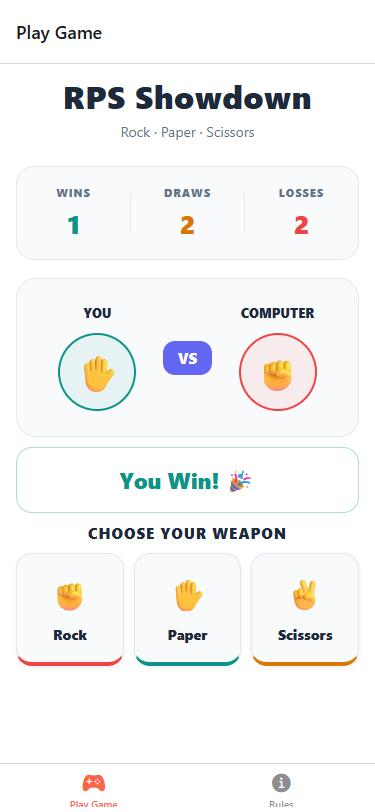
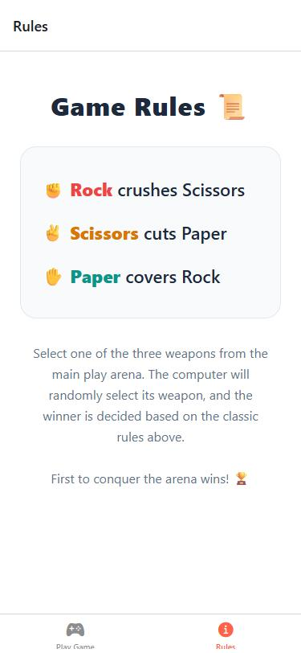

# RockPaperSnap – RPS Showdown

Mobile Application Development – Practical Tutorial 05: *Interactive Game Development with Expo Router*
Department of Statistics & Computer Science, University of Kelaniya (2024/2025, Semester 2)

RockPaperSnap is a Rock · Paper · Scissors game built with React Native and Expo (SDK 58) in VS Code.
You choose a weapon, the computer picks one at random, and a scoreboard tracks your wins, draws and losses.
The app has two tabs, **Play Game** and **Rules**, and its own splash screen.

## What we built in this lab

| Step | What was done |
| --- | --- |
| 1. Project setup | Created the project with `npx create-expo-app RockPaperSnap`, removed the starter template screens, and installed `@expo/vector-icons` for the tab bar icons. |
| 2. Splash screen | Added the game logo at `assets/images/appIcon.png` and set it as the app icon and the splash image (`resizeMode: contain`, white `#FFFFFF` background) in `app.json`. Android uses `appIcon-padded.png`, a copy with extra white space around the logo, for both its home-screen icon and its splash screen. |
| 3. Play screen | `src/app/(tabs)/index.tsx` holds the game engine. It uses `useState` for the player's choice, the computer's random choice, the result message and colour, and the score object. `playGame()` applies the classic rules and updates the score with functional `setScore(prev => …)` updates. |
| 4. Rules tab | `src/app/(tabs)/rules.tsx` is a scrollable `ScrollView` screen that explains the rules, using nested `Text` for the coloured weapon names. |
| 5. Tab layout | `src/app/(tabs)/_layout.tsx` uses Expo Router `Tabs` to make the two tabs, with Ionicons `game-controller` and `information-circle` icons and a `#FF6347` active tint. |
| 6. Root layout | `src/app/_layout.tsx` is a `Stack` that hides its own header for the `(tabs)` group, so only the tab header shows. |
| 7. Running | Tested live with Expo Go (`npx expo start -c`). A standalone APK can be built with EAS (`eas build -p android --profile preview`). |

### UI and styling concepts used

- **Flexbox layouts**: `flexDirection: 'row'` for the scoreboard, the arena (YOU – VS – COMPUTER) and the three weapon buttons, with `flex: 1` columns that share the width equally.
- **Dynamic styles**: style arrays such as `[styles.emojiCircle, userChoice && {...}]` colour the chosen weapon's circle, and the result box border changes with the result colour (`${resultColor}55` adds transparency to the hex colour).
- **Lists from data**: the weapon buttons are rendered with `CHOICES.map(...)` and `TouchableOpacity`.

## Project structure

```
RockPaperSnap/
├── app.json                 # app name, icon and splash screen config
├── assets/images/
│   ├── appIcon.png          # game logo (app icon, iOS splash)
│   └── appIcon-padded.png   # same logo with margin (Android icon + splash)
├── Output_Screens/          # output screenshots
└── src/app/
    ├── _layout.tsx          # root Stack navigator
    └── (tabs)/
        ├── _layout.tsx      # bottom tab navigator
        ├── index.tsx        # Play Game screen
        └── rules.tsx        # Rules screen
```

## How to run

```bash
npm install
npx expo start -c
```

Scan the QR code with the Expo Go app (Android) or the Camera app (iOS). Your phone and computer must be on the same Wi-Fi network.

To build an installable Android APK:

```bash
npm install -g eas-cli
eas login
eas build:configure
eas build -p android --profile preview
```

## Notes for Expo SDK 58

- SDK 58 no longer supports the top-level `"splash"` key shown in the lab sheet. The same settings (image, `contain`, `#FFFFFF`) go in the `expo-splash-screen` plugin in `app.json`. In Expo Go, the SDK 58 loading screen shows only the app name, so the splash screen and icon only appear in a built APK.
- Android 12 and newer crop the splash logo and the home-screen icon to a circle, which would cut off the edges of the original logo. `appIcon-padded.png` shrinks the logo so it fits inside that circle.
- `web.output` is set to `"single"`. With the template's `"server"` mode, the web dev server ran out of memory on the first page load.

## Output screens

| Play Game | Rules |
| --- | --- |
|  |  |
